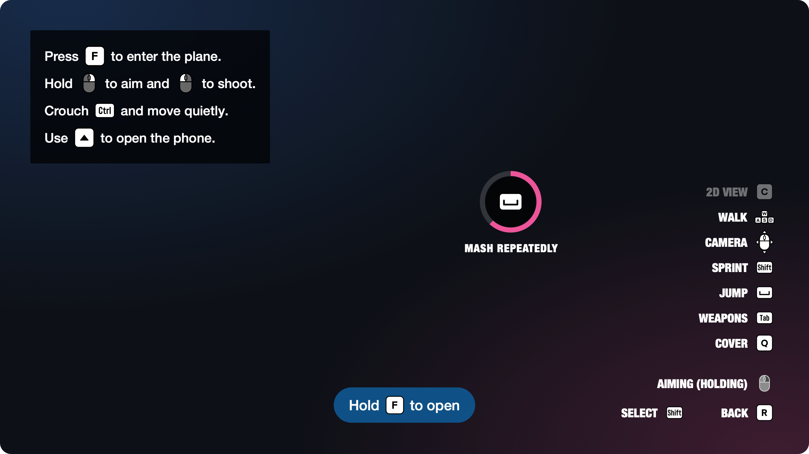
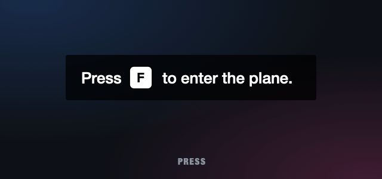
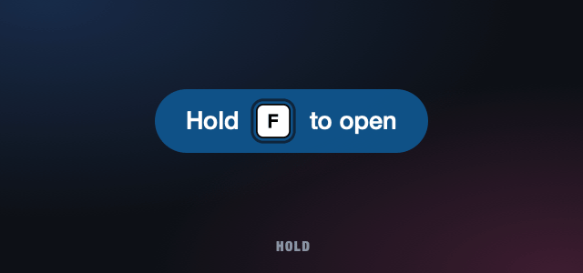
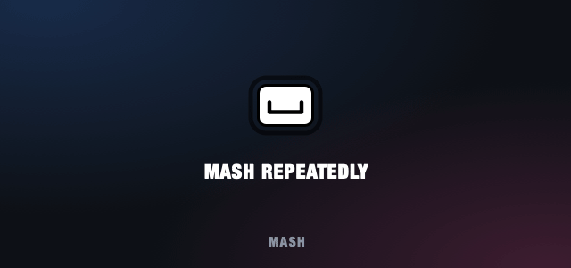
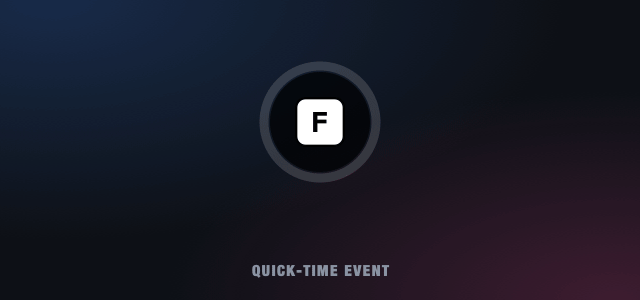
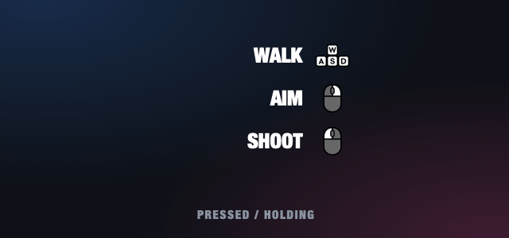
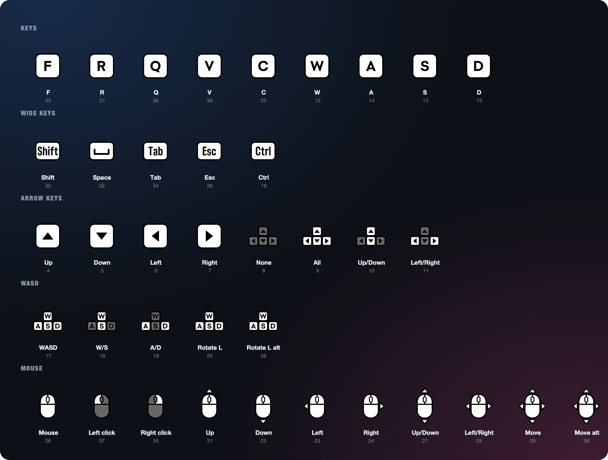
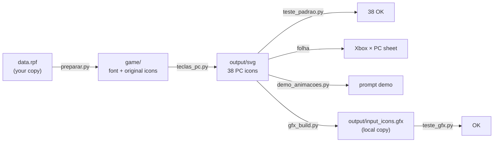

<p align="center">
  
</p>

<p align="center"><b>English</b> · <a href="README.pt-BR.md">Português (BR)</a></p>

<p align="center">
  
</p>

## What it is

GTA VI shows controller buttons (A, B, X, Y, LB, RT, sticks, D-pad) in prompts
such as "Press **Y** to enter". This project redraws **only the artwork** of
those icons with the matching PC key. The game logic that decides, animates and
tints the prompts stays exactly the same.

- **38 icons**, one for each `Main_Button_N` symbol.
- **Same style as the UI**: white shape, black details, and lettering in the
  interface's own typeface (`gta_art_deco_bold`).
- **Same size standard** as the originals (64-unit space), checked by a test.
- **No circles**: the circle is console language.

## The prompts in motion

| Press | Hold | Mash |
|:-:|:-:|:-:|
|  |  |  |
| **Quick-time event** | **Pressed / holding** | |
|  |  | |

Values read from the game's own prompt code: a pressed icon shrinks to 0.8 and
changes colour over 6 frames, the completion glow is 50%, and the QTE uses a
pink arc on a 15% track.

## All 38 icons

<p align="center">
  
</p>

> [!IMPORTANT]
> **No game files are in this repository.** To generate the icons you need
> **your own copy** of the game: `tools/preparar.py` extracts the interface font
> and the original icons (for comparison) from it. Tested with the Xbox Series
> build 1.0.2.1. The images above use the game's typeface for the key letters,
> as rendered pictures only.

## How it works



## Requirements

| | |
|---|---|
| **Python 3.9+** | standard library only; generates the icons on any OS |
| **Swift** (optional, macOS) | size test, comparison sheet and README images |
| **ffmpeg** (optional) | README GIFs |

## Usage

```sh
# 1. Extract from your copy (read-only; creates the game/ folder)
python3 tools/preparar.py "/path/to/data.rpf"

# 2. Generate the 38 PC icons as SVG
python3 tools/teclas_pc.py output/svg

# 3. Check against the approved set (38 OK)
(cd output/svg && shasum -a 256 -c ../../approved/teclas_pc.sha256)

# 4. Write the drawings into a COPY of the icon file (stays in output/, never commit it)
python3 tools/gfx_build.py game/input_icons.gfx output/svg output/input_icons.gfx

# 5. Check the new file: untouched code and names, 38 buttons, pixel match (macOS + ffmpeg)
python3 tools/teste_gfx.py game/input_icons.gfx output/input_icons.gfx output/svg

# 6. Make a patched COPY of data.rpf (the original is only read)
python3 tools/gfx_build.py game/input_icons.gfx output/svg output/input_icons_full.gfx --tamanho-original
python3 tools/rpf_patch.py "/path/to/data.rpf" output/input_icons_full.gfx output/data.rpf
```

On Windows, `tools/pasta_pc.ps1` builds a mirror folder of the game (hard
links and junctions to your files, only `data.rpf` replaced by the patched
copy), so your game folder is never touched; `desmontar` removes only the
links.

<details>
<summary><b>Size test, comparison sheet, demo and README images</b></summary>

```sh
# Compile the Swift tools (macOS)
for t in medir folha raster texto_svg; do swiftc -O tools/$t.swift -o tools/$t; done

# Size test: "38 ícones, 0 com falha"
python3 tools/teste_padrao.py output/svg

# Xbox × PC sheet at the same scale
args=(); for f in output/svg/botao_*.svg; do n=$(basename "$f"); args+=("game/xbox64/$n" "$f"); done
FOLHA_ESCALA_COMUM=1 tools/folha output/comparison.png 8 128 "${args[@]}"

# Interactive prompt demo (offline HTML, PC / Xbox toggle, try your own keys)
python3 tools/demo_animacoes.py game/xbox64 output/svg output/demo.html

# README images
python3 tools/banner.py docs/banner.svg
python3 tools/vitrine.py docs
python3 tools/gifs.py docs/gifs
```
</details>

## Mapping

| N | Controller | PC |
|:-:|---|---|
| 30 | A | `Shift` |
| 31 | B | `R` |
| 32 | X | `Space` |
| 33 | Y | `F` |
| 34 | LB | `Tab` |
| 35 | LT | right mouse button |
| 36 | RB | `Q` |
| 37 | RT | left mouse button |
| 38 | Menu | `Esc` |
| 39 | View | `V` |
| 12–15 | left stick, one direction | `W` `S` `A` `D` |
| 16 | L3 | `Ctrl` |
| 17–20, 58 | left stick, neutral / pairs / rotate | WASD block |
| 21–24, 27, 28 | right stick, directions | mouse with arrows |
| 25 | R3 | `C` |
| 26 | right stick, neutral | mouse |
| 29, 59 | rotate right stick | move the mouse (4 arrows) |
| 4–7 | D-pad, one direction | arrow key |
| 8–11 | D-pad, none / all / pairs | arrow-key block |

## Layout

```
tools/                 (code comments are in Portuguese)
  preparar.py        extracts the font and original icons from your copy
  rpf9_garimpo.py    reads the .rpf (read-only)
  gfx_svg.py         converts the original icons to SVG
  fonte_jogo.py      text → vector outline in the interface typeface
  teclas_pc.py       generates the 38 PC icons
  teste_padrao.py    size test (uses medir.swift)
  folha.swift        comparison sheet
  demo_animacoes.py  interactive prompt demo
  gfx_build.py       writes the drawings into a copy of input_icons.gfx
  teste_gfx.py       checks that copy (tags, sprites, size, pixel match)
  rpf_patch.py       patched copy of data.rpf with the new icon file
  pasta_pc.ps1       Windows: mirror folder with the patched data.rpf
  banner.py, vitrine.py, gifs.py, raster.swift, texto_svg.swift   README images
  limpar_metadados.py  strips image metadata (EXIF, colour profile, dates) before publishing
approved/            approved mouse and checksums of the 38 icons
docs/                README images
DESIGN.md            drawing rules, sizes, typography and tests (ANCORA.md in Portuguese)
```

## Status

- [x] 38 approved PC drawings
- [x] Size test, comparison sheet, interactive demo
- [x] Write the drawings into a copy of `input_icons.gfx`: each `Main_Button_N`
      keeps its id, name and class; code and export tables stay byte-identical;
      the new file is smaller than the original; every button matches the
      approved drawing when read back (SSIM ≥ 0.998)
- [x] Patched copy of `data.rpf` (same offset, rest byte-identical) and a
      Windows mirror-folder script
- [ ] In-game test on Windows

---

<sub>Personal, private project.</sub>
