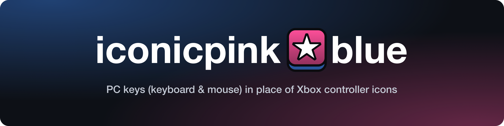
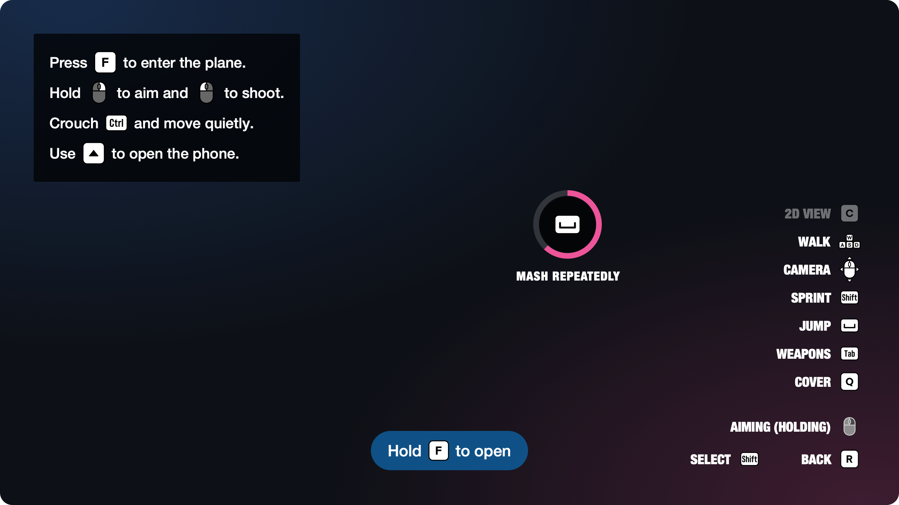
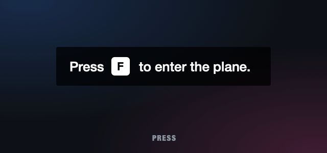
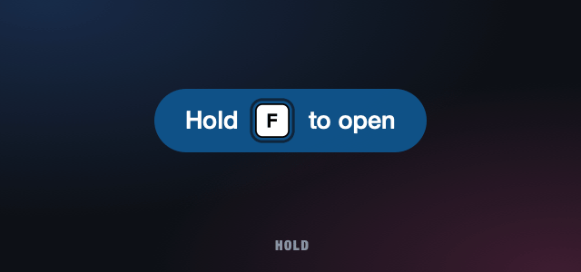
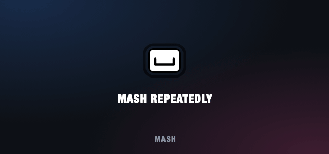
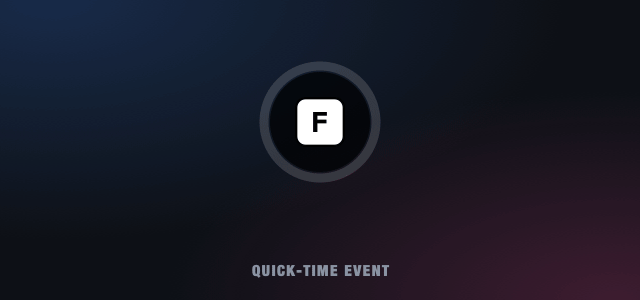
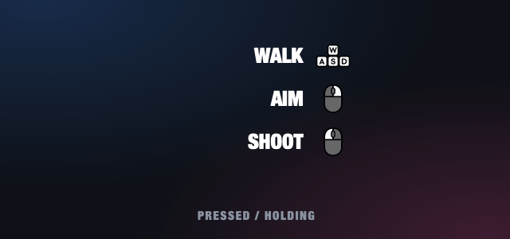
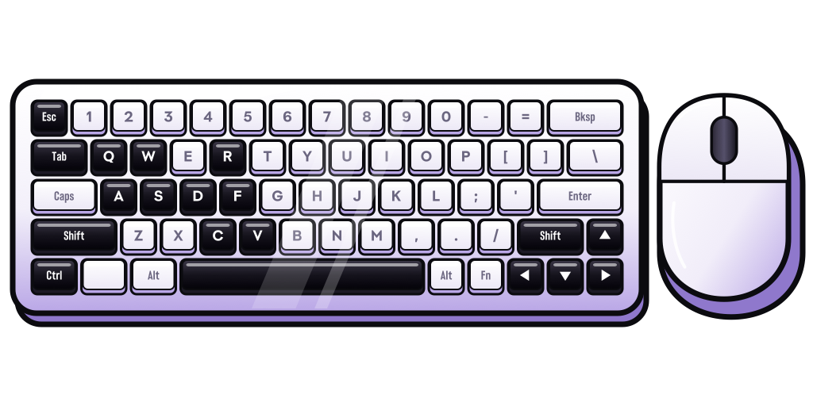
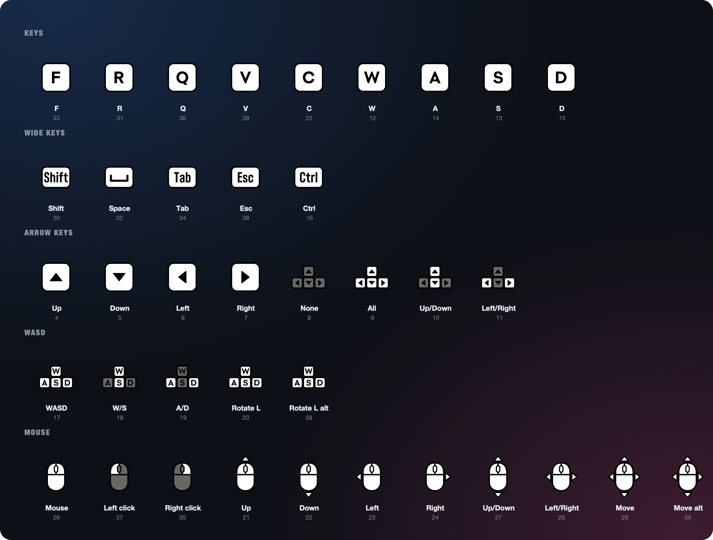
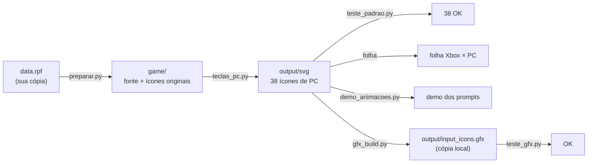

<p align="center">
  
</p>

<p align="center"><a href="README.md">English</a> · <b>Português (BR)</b></p>

<p align="center">
  
</p>

## O que é

O GTA VI mostra os botões do controle (A, B, X, Y, LB, RT, analógicos,
direcional) em prompts como "Pressione **Y** para entrar". Este projeto
redesenha **só o desenho** desses ícones com a tecla de PC equivalente. A
lógica do jogo que decide, anima e pinta os prompts continua igual.

- **38 ícones**, um para cada símbolo `Main_Button_N`.
- **Mesmo estilo da interface**: forma branca, detalhes pretos e letras na
  fonte da própria interface (`gta_art_deco_bold`).
- **Mesmo padrão de tamanho** dos originais (espaço de 64), conferido por teste.
- **Sem círculos**: o círculo é linguagem de console.

## Os prompts em movimento

| Apertar | Segurar | Apertar repetido |
|:-:|:-:|:-:|
|  |  |  |
| **Evento de tempo (QTE)** | **Apertado / segurando** | |
|  |  | |

Valores lidos do próprio código de prompts do jogo: o ícone apertado encolhe
para 0,8 e troca de cor em 6 quadros, o brilho de conclusão é de 50% e o QTE
usa um arco rosa sobre um trilho a 15%.

## A tela de controles

O menu de configurações mostra um desenho do controle. Ele é trocado por um
teclado e mouse no mesmo estilo, com as teclas que o jogo usa em preto.

<p align="center">
  
</p>

## Os 38 ícones

<p align="center">
  
</p>

> [!IMPORTANT]
> **Nenhum arquivo do jogo está neste repositório.** Para gerar os ícones é
> preciso a **sua cópia** do jogo: o `tools/preparar.py` tira dela a fonte da
> interface e os ícones originais (para comparar). Testado com a versão de Xbox
> Series 1.0.2.1. As imagens acima usam a fonte do jogo nas letras das teclas,
> só como imagem.

## Como funciona



## Requisitos

| | |
|---|---|
| **Python 3.9+** | só a biblioteca padrão; gera os ícones em qualquer sistema |
| **Swift** (opcional, macOS) | teste de tamanho, folha de comparação e imagens do README |
| **ffmpeg** (opcional) | GIFs do README |

## Uso

```sh
# 1. Extrair da sua cópia (só lê o .rpf; cria a pasta game/)
python3 tools/preparar.py "/caminho/para/data.rpf"

# 2. Gerar os 38 ícones de PC em SVG
python3 tools/teclas_pc.py output/svg

# 3. Conferir com os aprovados (38 OK)
(cd output/svg && shasum -a 256 -c ../../approved/teclas_pc.sha256)

# 4. Gravar os desenhos numa CÓPIA do arquivo de ícones (fica em output/, nunca commitar)
python3 tools/gfx_build.py game/input_icons.gfx output/svg output/input_icons.gfx

# 5. Conferir o arquivo novo: código e nomes intactos, 38 botões, pixel a pixel (macOS + ffmpeg)
python3 tools/teste_gfx.py game/input_icons.gfx output/input_icons.gfx output/svg

# 6. Fazer uma CÓPIA do data.rpf com o patch (o original só é lido)
python3 tools/gfx_build.py game/input_icons.gfx output/svg output/input_icons_full.gfx --tamanho-original
python3 tools/rpf_patch.py "/caminho/para/data.rpf" output/input_icons_full.gfx output/data.rpf

# 7. Tela de controles: teclado + mouse numa CÓPIA do platform.ttpf (macOS)
python3 tools/controle_pc.py output/controls.svg
tools/raster output/controls.svg output/controls.png 1024
python3 tools/ttpf_patch.py "/caminho/para/data/ttdb/ui/platform.ttpf" output/controls.png output/platform.ttpf
```

No Windows, o `tools/pasta_pc.ps1` monta uma pasta-espelho do jogo (hard
links e junções para os seus arquivos, só o `data.rpf` e o
`data\ttdb\ui\platform.ttpf` trocados pelas cópias), então a pasta do jogo
nunca é tocada; o `desmontar` remove só os atalhos e se recusa a rodar em
qualquer pasta que não seja a espelho.

<details>
<summary><b>Teste de tamanho, folha de comparação, demo e imagens do README</b></summary>

```sh
# Compilar as ferramentas em Swift (macOS)
for t in medir folha raster texto_svg; do swiftc -O tools/$t.swift -o tools/$t; done

# Teste de tamanho: "38 ícones, 0 com falha"
python3 tools/teste_padrao.py output/svg

# Folha Xbox × PC na mesma escala
args=(); for f in output/svg/botao_*.svg; do n=$(basename "$f"); args+=("game/xbox64/$n" "$f"); done
FOLHA_ESCALA_COMUM=1 tools/folha output/comparison.png 8 128 "${args[@]}"

# Demo interativa dos prompts (HTML sem internet, troca PC / Xbox, teste com suas teclas)
python3 tools/demo_animacoes.py game/xbox64 output/svg output/demo.html

# Imagens do README
python3 tools/vitrine.py docs
python3 tools/gifs.py docs/gifs
```
</details>

## Mapeamento

| N | Controle | PC |
|:-:|---|---|
| 30 | A | `Shift` |
| 31 | B | `R` |
| 32 | X | `Espaço` |
| 33 | Y | `F` |
| 34 | LB | `Tab` |
| 35 | LT | botão direito do mouse |
| 36 | RB | `Q` |
| 37 | RT | botão esquerdo do mouse |
| 38 | Menu | `Esc` |
| 39 | View | `V` |
| 12–15 | analógico esquerdo, uma direção | `W` `S` `A` `D` |
| 16 | L3 | `Ctrl` |
| 17–20, 58 | analógico esquerdo, neutro / pares / girar | bloco WASD |
| 21–24, 27, 28 | analógico direito, direções | mouse com setas |
| 25 | R3 | `C` |
| 26 | analógico direito, neutro | mouse |
| 29, 59 | girar o analógico direito | mover o mouse (4 setas) |
| 4–7 | direcional, uma direção | seta do teclado |
| 8–11 | direcional, nenhuma / todas / pares | bloco de setas |

## Estrutura

```
tools/
  preparar.py        extrai da sua cópia a fonte e os ícones originais
  rpf9_garimpo.py    lê o .rpf (só leitura)
  gfx_svg.py         converte os ícones originais para SVG
  fonte_jogo.py      texto → contorno vetorial na fonte da interface
  teclas_pc.py       gera os 38 ícones de PC
  teste_padrao.py    teste de tamanho (usa medir.swift)
  folha.swift        folha de comparação
  demo_animacoes.py  demo interativa dos prompts
  gfx_build.py       grava os desenhos numa cópia do input_icons.gfx
  teste_gfx.py       confere essa cópia (tags, sprites, tamanho, pixel a pixel)
  rpf_patch.py       cópia do data.rpf com o arquivo de ícones novo
  pasta_pc.ps1       Windows: pasta-espelho com os arquivos modificados
  controle_pc.py     desenho de teclado e mouse para a tela de controles
  ttpf_patch.py      grava esse desenho numa cópia do platform.ttpf (BC7)
  ttpf.py, detile.py leem texturas .ttpf e desfazem o tiling do console (só leitura)
  vitrine.py, gifs.py, raster.swift, texto_svg.swift   imagens do README
  limpar_metadados.py  tira metadados das imagens (EXIF, perfil de cor, datas) antes de publicar
approved/            mouse aprovado e conferência dos 38 ícones
docs/                imagens do README
ANCORA.md            regras de desenho, medidas, tipografia e testes (DESIGN.md em inglês)
```

## Estado

- [x] 38 desenhos de PC aprovados
- [x] Teste de tamanho, folha de comparação, demo interativa
- [x] Gravar os desenhos numa cópia do `input_icons.gfx`: cada `Main_Button_N`
      mantém id, nome e classe; código e tabelas de nomes ficam byte a byte
      iguais; o arquivo novo é menor que o original; relido, cada botão bate
      com o desenho aprovado (SSIM ≥ 0,998)
- [x] Cópia do `data.rpf` com o patch (mesmo offset, resto byte a byte igual) e
      script da pasta-espelho no Windows
- [x] Tela de controles: teclado e mouse gravados numa cópia do
      `platform.ttpf` (BC7, relido na GPU: SSIM 0,999)
- [ ] Teste no jogo no Windows

---

<sub>Projeto pessoal e privado.</sub>
