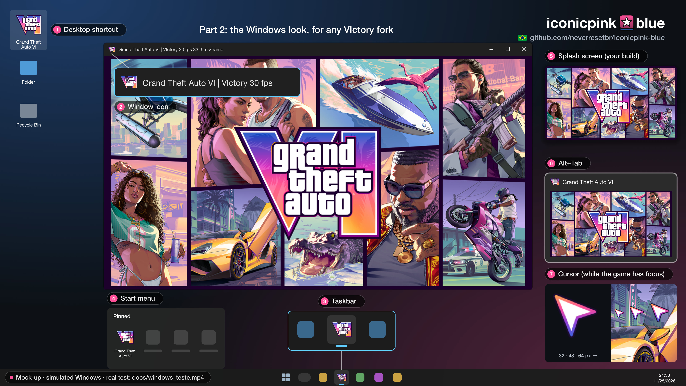

# Parte 2: visual do Windows

<p><a href="README.md">English</a> · <b>Português (BR)</b></p>

<p align="center">
  
</p>

> [!NOTE]
> A imagem acima e o [vídeo animado](../docs/windows_demo.mp4) são **simulações** do Windows,
> feitas para mostrar tudo de uma vez. O **teste real**, gravado no Windows 11, é o
> [windows_teste.mp4](../docs/windows_teste.mp4) (veja "Teste" abaixo).

Um **lançador** que abre o jogo pelo programa que você já usa e cuida só do
visual. Ele faz três coisas:

- mostra a **tela de abertura** do jogo, nítida em qualquer escala do
  Windows, até o jogo começar a desenhar;
- põe o **ícone** na janela do jogo, na barra de tarefas, no Alt+Tab, no
  atalho da Área de Trabalho e no Menu Iniciar;
- troca o **cursor**, se você quiser: ele vale só enquanto a janela do jogo
  está em foco e volta ao normal quando você sai.

Ele **não muda nenhuma linha** do VIctory nem dos forks. Funciona por fora,
então serve para qualquer um deles:

| Fork | Parte 1 (ícones das teclas) | Parte 2 (este lançador) |
|---|:-:|:-:|
| VIctory | ✅ | ✅ |
| Belobug/VIctory-Belobug-AMD | ✅ | ✅ |
| avatarmanz/VIctory-7900XTX | ✅ | ✅ |
| DexNom/VIctory (usa o `victory-play.exe` dele) | ✅ | ✅ |

Conferido lendo o código de cada um. Todos montam a pasta do jogo do mesmo
jeito, deixam o jogo criar a própria janela e escrevem "fps" no título dela
quando começam a desenhar; é esse sinal que fecha a tela de abertura.

> [!IMPORTANT]
> Nada do jogo está aqui. A tela de abertura vem da **sua** build
> (`xbs_splash.png`). O ícone sai de um PNG de logo seu (`-Logo`) ou, sem ele,
> do ícone oficial que a build traz (`xbs_logo_480.png`).

## Teste

[Vídeo do teste no Windows 11](../docs/windows_teste.mp4) (16 s): o atalho, a tela de
abertura, o ícone na janela e o cursor, com um "jogo de mentira" que imita a janela do jogo.

## Instalar

Precisa só do Windows 10 ou 11: o compilador de C# já vem com o .NET
Framework 4, e o instalador compila o `Lancador.cs` na hora.

```powershell
# VIctory, Belobug, avatarmanz (compilados por você)
powershell -ExecutionPolicy Bypass -File instalar.ps1 instalar `
  -Jogo "D:\jogo\game_scarlett_master.exe" -Logo "D:\logo.png" `
  -Programa "D:\VIctory\target\release\victory.exe" -Pasta "D:\VIctory" `
  -Argumentos 'run "D:\jogo\game_scarlett_master.exe" --execute'

# DexNom (depois do Setup.cmd dele)
powershell -ExecutionPolicy Bypass -File instalar.ps1 instalar `
  -Jogo "D:\jogo\game_scarlett_master.exe" -Logo "D:\logo.png" `
  -Programa "$env:LOCALAPPDATA\DexNom Runtime\victory-play.exe"
```

- `-Jogo`: o executável do jogo. Com a parte 1, use o da pasta-espelho.
- `-Logo` (opcional): PNG com fundo transparente. O ícone sai em 16 a 256 px.
- Cursor: por padrão, o nosso (`cursor/radar.cur`: seta do radar, miolo branco,
  filete no degradê do logo). `-Cursor` usa outro `.cur`; `-SemCursor` não troca o cursor.
- `-Nome` (opcional): o nome do atalho (padrão "Grand Theft Auto VI").

O instalador cria `%LOCALAPPDATA%\iconicpink-blue` (com o lançador e a pasta
`visual`) e os atalhos. Para desfazer:

```powershell
powershell -ExecutionPolicy Bypass -File instalar.ps1 remover
```

## Como funciona

1. O atalho abre o `Lancador.exe`, que abre o seu programa com os mesmos
   argumentos de sempre.
2. O lançador acompanha esse processo, os processos que ele abre e o jogo,
   se ele se relançar.
3. Quando a janela do jogo aparece, recebe o ícone (`WM_SETICON`).
4. A tela de abertura some quando o título da janela ganha "fps", ou depois
   de 2 minutos.
5. Quando o jogo fecha, o lançador devolve o cursor do Windows e sai.

## Limites

- Abrir o `victory.exe` direto, sem o atalho, abre o jogo sem esse visual.
- O próprio `victory.exe` continua com o ícone padrão no Explorer; o
  `Lancador.exe`, o atalho e a janela ficam com o novo.
